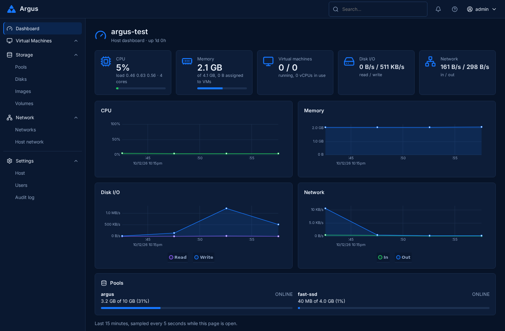
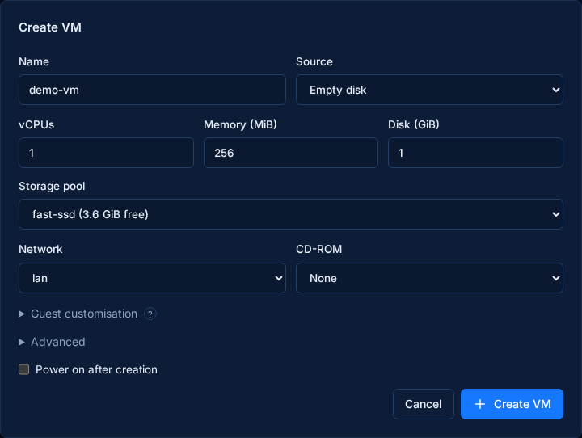
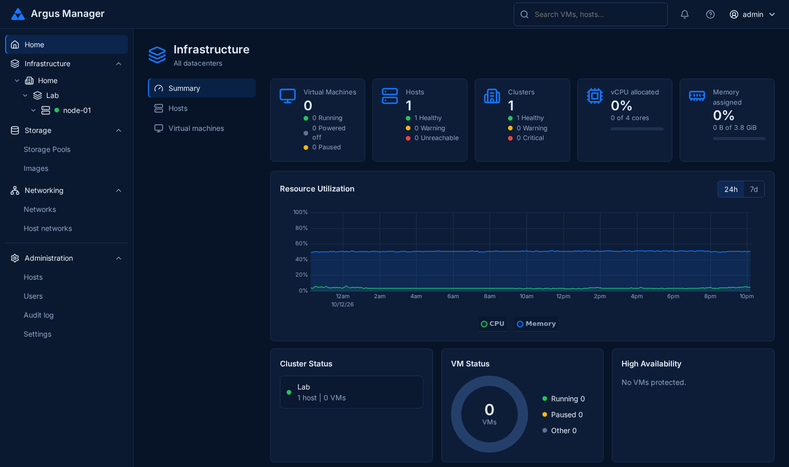

# Argus

Create and manage virtual machines from your browser. Argus is a lightweight KubeVirt hypervisor on Kairos and K3s. **Argus Manager** adds optional fleet orchestration.

**Experimental alpha.** See [security and deployment limits](SECURITY.md).

## Host

VMs, storage and networking on a single host.



- VM provisioning, OVA/ESXi import, image uploads and VNC/serial consoles.
- Local ZFS pools, disks, snapshots, clones and scheduled NFS backups.
- Bridges, VLANs and management networking.
- Local users, roles, host metrics and OS upgrades.

<details>
<summary>VM provisioning</summary>

Choose CPU, memory, storage and networking; add cloud-init guest settings.



</details>

## Manager

One view across your hosts.



- Fleet inventory, host groups, metrics and consoles.
- Shared image library, VM templates and placement.
- Cold migration, scheduled replication and manual failover; experimental live migration.
- Maintenance mode, rolling updates and host profiles.
- Organizations, scoped roles, local users, OIDC and encrypted configuration backups.

Automatic failover is disabled by default.

*Screenshots from a single-host lab. VM provisioning is shown before submission.*

## Architecture

Each host runs an independent single-node K3s cluster with SQLite, KubeVirt, CDI, Multus/bridge CNI and OpenEBS ZFS LocalPV. The OS is Kairos on Ubuntu 26.04 with KVM.

Storage is local per host. Migration and replication copy VM data between hosts. Manager uses host HTTPS APIs with node tokens and pinned CAs.

[Architecture diagram](docs/architecture.drawio)

## Requirements

| Resource | Minimum / target |
|---|---|
| CPU | 2 cores with VT-x or AMD-V; 4 recommended |
| Host memory | 4 GiB for testing; 8 GiB or more recommended |
| Idle memory | Previously measured around 1.9 GiB; target ceiling 2.2 GiB |
| Disk | Separate OS and VM disks; at least 10 GiB each for testing |
| VM overhead | Estimated 150–250 MiB per VM, plus guest memory |

## Build and run

Go **1.27.2** and Docker with Buildx.

```sh
make manager
make iso
```

ISO output: `build/`. Set the SSH key, uplink and disk identifiers in [cloud-config](os/cloud-config.example.yaml). The installer overwrites the selected OS disk.

Run Manager with persistent storage:

```sh
docker run -d --name argus-manager -p 443:8443 \
  -e ARGUS_DATA=/home/nonroot/data \
  -v argus-manager:/home/nonroot argus-manager:0.1.0
docker logs argus-manager
```

Open HTTPS, change the initial admin password, then register hosts using their URL, API token and CA fingerprint.

## Development

[Contributing and AI policy](CONTRIBUTING.md) · [Agent guidelines](AGENTS.md) · [Security reporting](SECURITY.md)

`master` is the default and production branch. CI includes secret scanning. Version tags publish signed images with SBOMs and provenance after CI passes; tagged commits must belong to `master`.

## License

[GNU AGPLv3 only](LICENSE) (`AGPL-3.0-only`). [Third-party notices](THIRD_PARTY_NOTICES) cover bundled components. Release downloads include matching source archives.
